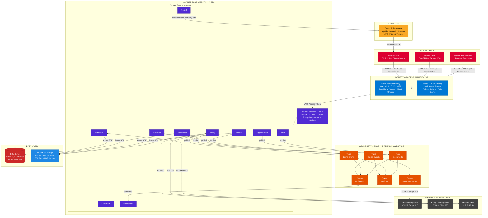
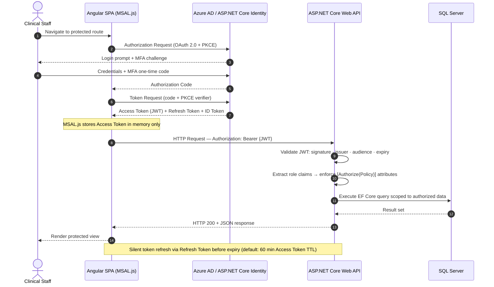
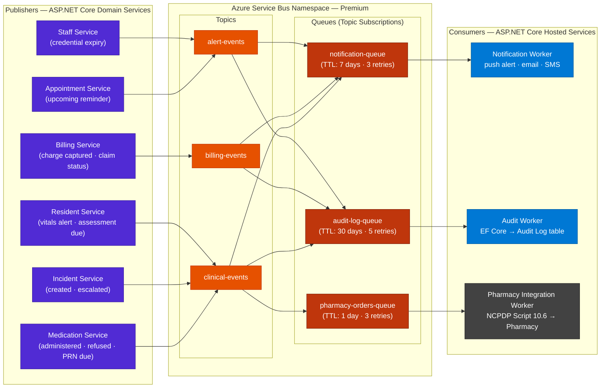
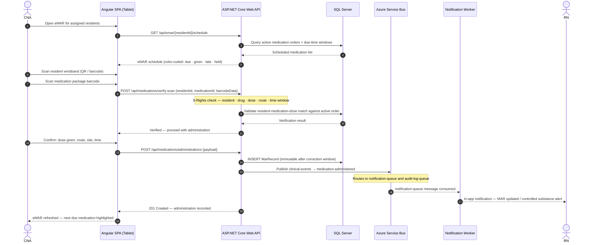
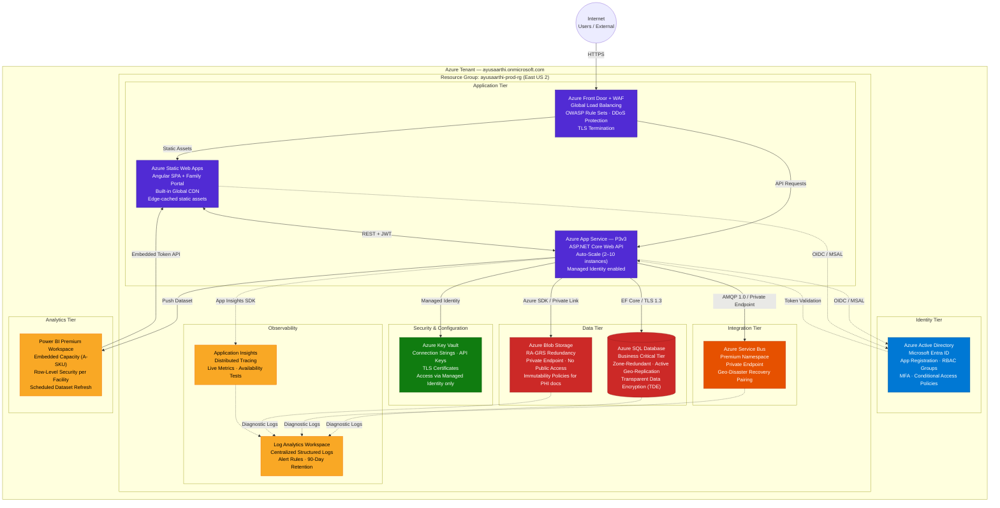
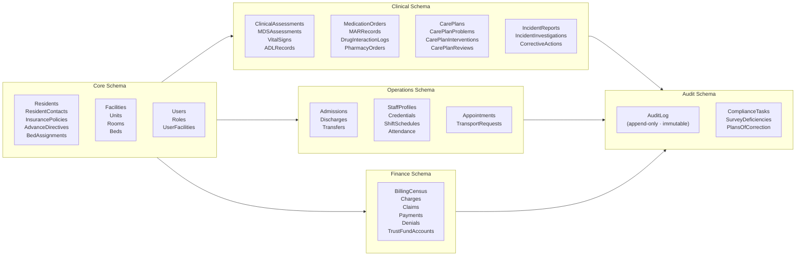

# AyuSaarthi HMS — System Architecture

**Version:** 1.0  
**Date:** 2026-08-31  
**Stack:** Angular · ASP.NET Core Web API (.NET 8) · SQL Server · Azure Blob Storage · Azure AD / ASP.NET Core Identity + JWT · Azure Service Bus · Power BI Embedded

---

## Table of Contents

1. [Technology Stack](#1-technology-stack)
2. [High-Level System Architecture](#2-high-level-system-architecture)
3. [Authentication & Authorization Flow](#3-authentication--authorization-flow)
4. [Async Event Flow — Azure Service Bus](#4-async-event-flow--azure-service-bus)
5. [Key Clinical Flow: Medication Administration](#5-key-clinical-flow-medication-administration)
6. [Azure Deployment Topology](#6-azure-deployment-topology)
7. [Security Architecture](#7-security-architecture)
8. [Data Architecture](#8-data-architecture)
9. [API Design Conventions](#9-api-design-conventions)

---

## 1. Technology Stack

| Layer | Technology | Version | Role |
|-------|-----------|---------|------|
| Frontend | Angular | 18 | SPA — clinical workflows, admin console, family portal |
| Auth — Option A | Azure Active Directory (Microsoft Entra ID) | — | Cloud-managed identity, OIDC / OAuth 2.0, MFA, RBAC Groups |
| Auth — Option B | ASP.NET Core Identity + JWT Bearer | .NET 8 | Self-hosted identity, role-based JWT claims, refresh tokens |
| Backend | ASP.NET Core Web API | .NET 8 | RESTful API, domain logic, integrations, background workers |
| ORM | Entity Framework Core | 8 | SQL Server data access, migrations, auditing interceptors |
| Database | SQL Server / Azure SQL Database | 2022 | OLTP — all resident, clinical, operational, and billing data |
| File Storage | Azure Blob Storage | — | Consent docs, scanned forms, EDI files, exported PDF reports |
| Messaging | Azure Service Bus | Premium | Async, durable event-driven communication between services |
| Analytics | Power BI Embedded | — | Quality measure dashboards, billing analytics, ad-hoc reports |
| Logging | Serilog → Azure Log Analytics | — | Structured, centralized application and audit logs |
| Monitoring | Azure Application Insights | — | Distributed tracing, performance monitoring, alerting |

---

## 2. High-Level System Architecture

The system follows a **layered, event-driven architecture**. Angular SPAs consume a modular ASP.NET Core Web API secured by JWT Bearer tokens issued by either Azure AD (Option A) or ASP.NET Core Identity (Option B). Domain services communicate asynchronously via Azure Service Bus topics and queues. Power BI Embedded surfaces analytics directly within the Angular shell.

### 2.1 Layer Responsibilities

| Layer | Technology | Responsibility |
|-------|-----------|----------------|
| Client | Angular 18 | SPA rendering, MSAL.js token management, reactive state (NgRx), offline-capable eMAR via Service Worker |
| Identity | Azure AD / ASP.NET Core Identity | Token issuance, MFA enforcement, role/claim injection, token refresh |
| API | ASP.NET Core Web API | Domain logic, RBAC policy enforcement, EF Core ORM, background jobs (Hosted Services) |
| Messaging | Azure Service Bus | Durable async decoupling of clinical events, audit events, pharmacy orders, and notifications |
| Database | SQL Server / Azure SQL | OLTP for all PHI; auditing via EF Core interceptors; row-level security for multi-tenant isolation |
| Blob Storage | Azure Blob Storage | Binary file storage with private endpoints; SAS URL generation for time-limited secure access |
| Analytics | Power BI Embedded | Embedded reports rendered in Angular iFrame; row-level security (RLS) enforced per facility |
| External | FHIR / NCPDP / EDI | Standard protocol adapters — not direct SQL access to external systems |

---

## 3. Authentication & Authorization Flow

Two mutually exclusive identity strategies are supported. The API's middleware stack and Angular MSAL.js configuration are the only components that change between options.

| | Option A — Azure AD | Option B — ASP.NET Core Identity |
|--|--|--|
| **Token Issuer** | Microsoft Entra ID (cloud) | Local ASP.NET Core API (`/api/auth/token`) |
| **Protocol** | OAuth 2.0 + OIDC + PKCE | OAuth 2.0 Resource Owner (internal) |
| **MFA** | Azure AD Conditional Access (built-in) | TOTP via ASP.NET Core Identity + Authenticator app |
| **RBAC** | Azure AD Security Groups → API scope claims | ASP.NET Core Identity Roles → JWT role claims |
| **Token Storage** | MSAL.js in-memory cache | In-memory; refresh token in HttpOnly cookie |
| **Best For** | Enterprise facilities with Microsoft 365 | Self-hosted / on-premises deployment |

---

## 4. Async Event Flow — Azure Service Bus

Azure Service Bus decouples domain services from side-effect consumers (notifications, audit logging, pharmacy integration). Publishers emit events to **topics**; consumers receive messages via **queue subscriptions**, enabling independent scaling and retry without coupling.

### 4.1 Topic & Queue Catalog

| Topic | Published By | Event Examples | Subscribers |
|-------|-------------|----------------|-------------|
| `clinical-events` | Medication, Incident, Resident services | `medication-administered`, `incident-created`, `vitals-alert` | notification-queue, audit-log-queue, pharmacy-orders-queue |
| `billing-events` | Billing Service | `charge-captured`, `claim-submitted`, `payment-posted` | notification-queue, audit-log-queue |
| `alert-events` | Appointment, Staff services | `appointment-reminder`, `credential-expiry-warning`, `assessment-due` | notification-queue, audit-log-queue |

| Queue | Consumer | DLQ Handling |
|-------|---------|--------------|
| `notification-queue` | Notification Worker (push/email/SMS) | Undeliverable alerts logged and surfaced in Admin dashboard |
| `audit-log-queue` | Audit Worker | Failures retried with exponential back-off; critical audit failures alert Super Admin |
| `pharmacy-orders-queue` | Pharmacy Integration Worker | NCPDP transmission failures trigger in-app alert to Pharmacist for manual review |

---

## 5. Key Clinical Flow: Medication Administration

This sequence illustrates point-of-care eMAR administration with barcode verification, immutable record creation, and asynchronous audit/notification via Service Bus.

---

## 6. Azure Deployment Topology

All production resources are deployed in a single Azure Subscription within a primary region (e.g., East US 2) with geo-redundant data replication to a paired region (e.g., Central US). Azure Front Door provides global entry point, WAF, and DDoS protection.

### 6.1 Azure Resource Catalog

| Azure Resource | SKU / Tier | Purpose |
|---------------|-----------|---------|
| Azure Active Directory | P2 | MFA, Conditional Access, RBAC Groups |
| Azure Front Door + WAF | Premium | Global entry point, DDoS, OWASP WAF rules |
| Azure Static Web Apps | Standard | Angular SPA hosting with global CDN |
| Azure App Service | P3v3 (auto-scale 2–10) | ASP.NET Core Web API hosting |
| Azure SQL Database | Business Critical | Primary OLTP database, zone-redundant |
| Azure Blob Storage | RA-GRS + Private Endpoint | Unstructured file and document storage |
| Azure Key Vault | Standard | Secrets, certificates, connection strings |
| Azure Service Bus | Premium + Private Endpoint | Async messaging, geo-DR pairing |
| Application Insights | — | Distributed tracing, performance |
| Log Analytics Workspace | — | Centralized logging, alert rules |
| Power BI Premium Workspace | A-SKU (Embedded) | Embedded analytics with RLS |

---

## 7. Security Architecture

| Concern | Control |
|---------|---------|
| **Transport Security** | TLS 1.3 enforced end-to-end; HSTS headers set; all HTTP redirected to HTTPS at Front Door |
| **Data at Rest** | AES-256 on Azure SQL (TDE), Azure Blob Storage (SSE), and Azure Key Vault-managed keys |
| **Authentication** | JWT Bearer validation on every API request: signature, issuer (`iss`), audience (`aud`), expiry (`exp`) |
| **Authorization** | Attribute-based RBAC via `[Authorize(Policy = "...")]`; role claims mapped from Azure AD Groups or ASP.NET Core Identity Roles |
| **MFA** | Azure AD Conditional Access (Option A); TOTP via ASP.NET Core Identity (Option B) — mandatory for Admin, Physician, Pharmacist roles |
| **Session Management** | Access Token TTL: 60 minutes; Refresh Token TTL: 8 hours; silent renewal via MSAL.js; idle session timeout: 15 minutes (configurable) |
| **Account Lockout** | Locked after 5 failed login attempts; unlocked via admin action or email-verified self-service |
| **PHI Access Logging** | Every GET/POST/PUT/DELETE on PHI entities recorded in Audit Log via EF Core `SaveChanges` interceptor; immutable append-only table |
| **Blob Storage Access** | No public access; time-limited SAS URLs (default: 5 minutes) generated by API for each file download; all access logged |
| **Service Bus** | Private endpoint; AMQP with Managed Identity (no connection string in code); messages encrypted in transit and at rest |
| **API Security** | OWASP Top 10 mitigated at WAF; rate limiting (per-IP + per-user) via ASP.NET Core middleware; CORS policy restricted to known origins |
| **Secrets Management** | No secrets in code or config files; all loaded at runtime from Azure Key Vault via Managed Identity |
| **Dependency Scanning** | Automated OWASP Dependency-Check in CI pipeline; critical CVEs block deployment |
| **Penetration Testing** | Annual third-party pentest; findings remediated: Critical ≤ 24 h, High ≤ 7 days, Medium ≤ 30 days |

---

## 8. Data Architecture

SQL Server hosts all OLTP data organized into functional schema groups, with row-level security (RLS) enforcing facility-level data isolation in multi-tenant deployments. Azure Blob Storage holds only binary files; all metadata and references are stored in SQL Server.

### 8.1 Database Schema Groups

### 8.2 Key Design Decisions

| Decision | Rationale |
|----------|-----------|
| Audit log is append-only with no UPDATE/DELETE grants | Satisfies HIPAA, 21 CFR Part 11 audit defensibility |
| MAR records are immutable after a configurable correction window (default: 24 h) | Prevents backdating; corrections created as addenda |
| Soft deletes for all clinical entities | Preserves data lineage; discharged resident records retained in read-only archive for 7 years |
| Azure Blob Storage for documents with metadata in SQL | Avoids bloating the relational DB; enables efficient indexing and querying of document metadata |
| Multi-tenant row-level security via `FacilityId` column | Ensures facility-level data isolation without separate databases per tenant |
| EF Core `SaveChangesInterceptor` for change tracking | Captures old/new values for audit log without application-layer boilerplate |

---

## 9. API Design Conventions

- **Versioning:** URI versioning — `/api/v1/...`; breaking changes increment the major version.
- **Authentication:** Every endpoint requires `[Authorize]`; no anonymous endpoints expose PHI.
- **Authorization:** Fine-grained control via named policies, e.g., `[Authorize(Policy = "CanAdministerMedications")]`.
- **Response envelope:** Consistent JSON structure — `{ data, meta, errors }`.
- **Pagination:** Cursor-based pagination for large collections via `?cursor=&pageSize=`.
- **Error responses:** RFC 9457 Problem Details (`application/problem+json`) for all 4xx/5xx responses.
- **Idempotency:** `Idempotency-Key` header supported on POST endpoints for safe client retries.
- **File downloads:** API generates a short-lived SAS URL (5-minute TTL) and returns it to the client; client fetches directly from Azure Blob Storage.
- **Health checks:** `/api/health` (liveness) and `/api/health/ready` (readiness) exposed for App Service and Azure Monitor.
- **Rate limiting:** 1,000 requests/minute per authenticated user; 100/minute per unauthenticated IP (login endpoint only).
- **FHIR integration:** A dedicated `FhirAdapter` service translates internal domain models to/from HL7 FHIR R4 resources; no FHIR types leak into the core domain layer.

---

*Document Owner: AyuSaarthi HMS Architecture Team*  
*Review Cycle: Per major release or on infrastructure change*  
*Next Review Date: 2026-11-30*
