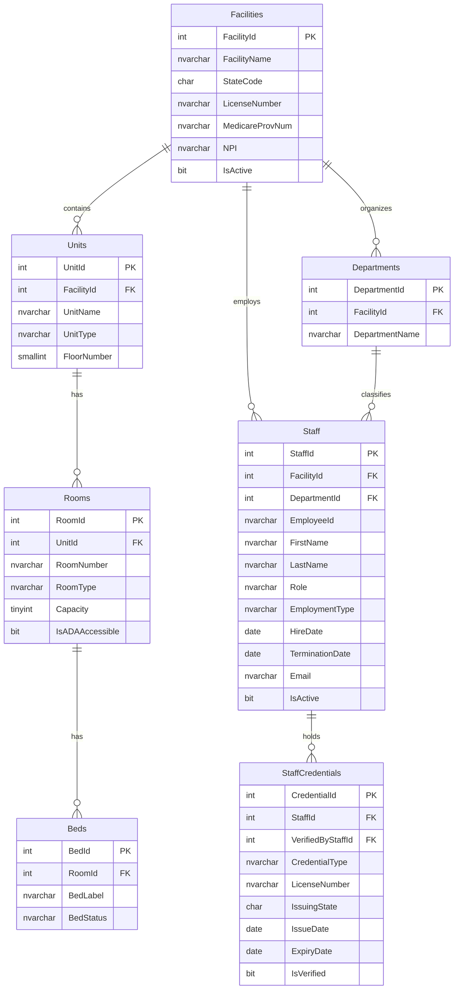
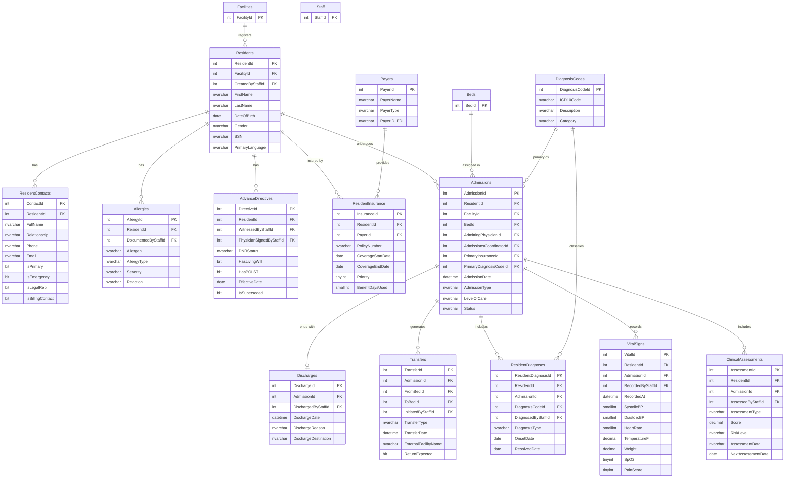
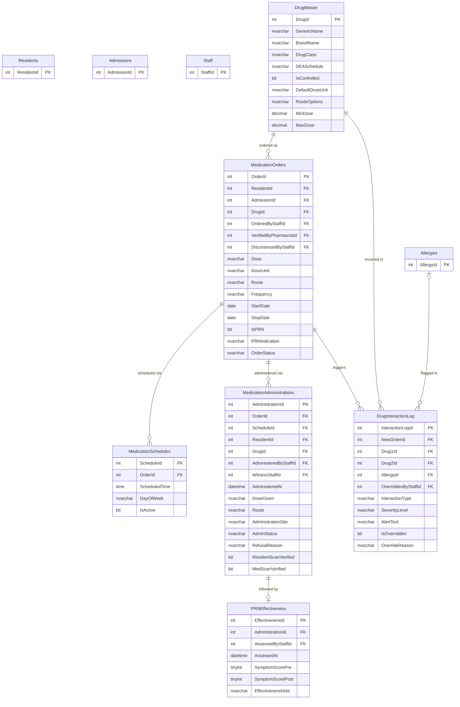
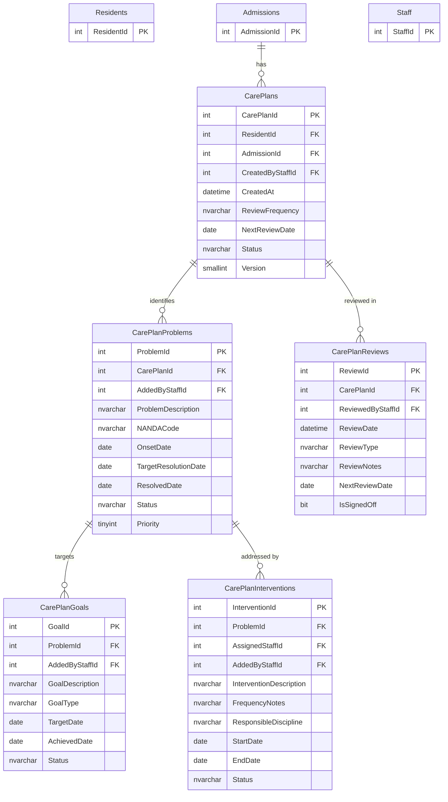
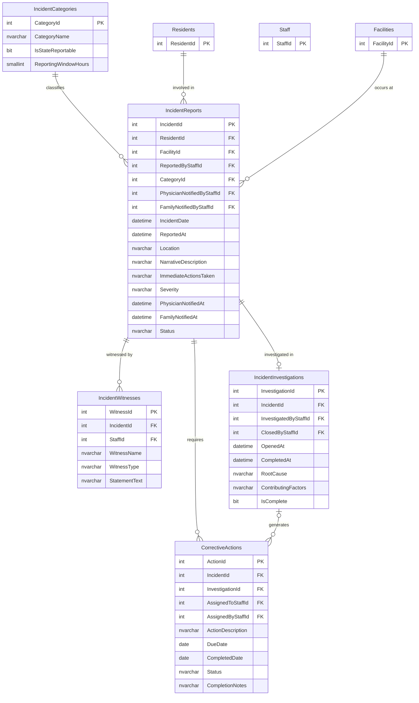
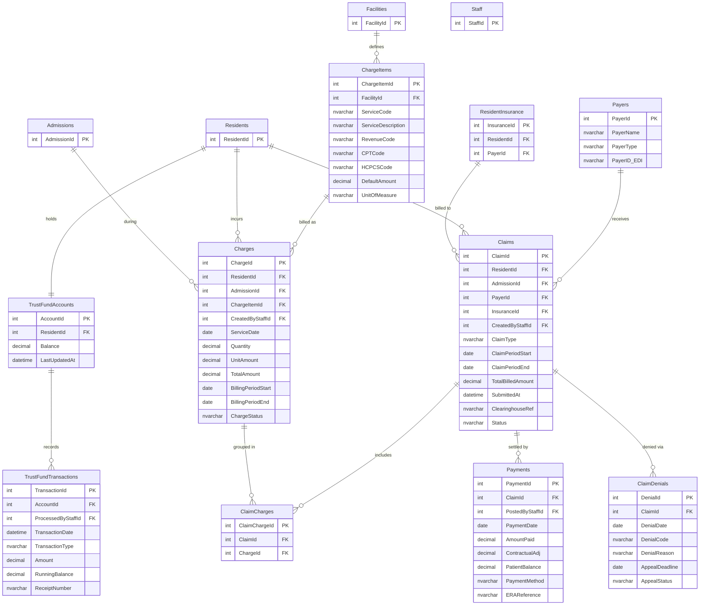

# AyuSaarthi HMS — Database Schema

**Version:** 1.0  
**Date:** 2026-08-31  
**RDBMS:** SQL Server 2022 / Azure SQL Database  
**Normal Form:** Third Normal Form (3NF)

---

## Table of Contents

1. [Schema Overview](#1-schema-overview)
2. [ER Diagrams](#2-er-diagrams)
   - 2.1 Infrastructure & Staff
   - 2.2 Residents & Admissions
   - 2.3 Medications
   - 2.4 Care Plans
   - 2.5 Incidents
   - 2.6 Billing & Finance
3. [SQL Create Scripts](#3-sql-create-scripts)
4. [Reference Data (Seed SQL)](#4-reference-data-seed-sql)
5. [Index Strategy](#5-index-strategy)
6. [Design Decisions](#6-design-decisions)

---

## 1. Schema Overview

| Module | Tables | Description |
|--------|--------|-------------|
| Infrastructure & Staff | 7 | Facilities, units, rooms, beds, departments, staff, credentials |
| Residents | 6 | Resident profiles, contacts, allergies, insurance, diagnoses, advance directives |
| Admissions | 6 | Admissions, discharges, transfers, vitals, clinical assessments, diagnosis codes |
| Medications | 6 | Drug master, orders, schedules, administrations, PRN effectiveness, DDI log |
| Care Plans | 5 | Care plans, problems, goals, interventions, reviews |
| Incidents | 5 | Incident categories, reports, witnesses, investigations, corrective actions |
| Billing & Finance | 8 | Charge items, charges, claims, claim-charges, payments, denials, trust fund |
| Payers | 1 | Payer master (shared by Residents and Billing modules) |
| Audit | 1 | Immutable append-only audit log |
| **Total** | **45** | |

---

## 2. ER Diagrams

### 2.1 Infrastructure & Staff

---

### 2.2 Residents & Admissions

---

### 2.3 Medications

---

### 2.4 Care Plans

---

### 2.5 Incidents

---

### 2.6 Billing & Finance

---

## 3. SQL Create Scripts

> Full runnable scripts are in [database/schema.sql](database/schema.sql).  
> Reference / seed data is in [database/seed_data.sql](database/seed_data.sql).

---

## 4. Index Strategy

| Table | Index | Columns | Rationale |
|-------|-------|---------|-----------|
| Residents | IX_Residents_Name | LastName, FirstName | Resident search by name |
| Residents | IX_Residents_Facility | FacilityId | Census and reporting queries |
| Admissions | IX_Admissions_Status | FacilityId, Status | Active census board queries |
| Admissions | IX_Admissions_Resident | ResidentId | Resident history lookups |
| MedicationOrders | IX_MedOrders_ActiveRes | ResidentId, OrderStatus | eMAR schedule generation |
| MedicationAdministrations | IX_MedAdmin_ResDate | ResidentId, AdministeredAt DESC | MAR history lookups |
| VitalSigns | IX_Vitals_ResDate | ResidentId, RecordedAt DESC | Clinical trending |
| IncidentReports | IX_Incidents_FacDate | FacilityId, IncidentDate | QAPI reporting |
| Charges | IX_Charges_ResStatus | AdmissionId, ChargeStatus | Unbilled charge sweep |
| Claims | IX_Claims_PayerStatus | PayerId, Status | A/R aging queries |
| StaffCredentials | IX_Creds_Expiry | ExpiryDate, StaffId | Expiry alert queries |
| AuditLog | IX_Audit_Table | TableName, RecordId, ChangedAt DESC | PHI access lookups |
| AuditLog | IX_Audit_User | ChangedByUserId, ChangedAt DESC | User activity audit |

---

## 5. Design Decisions

| Decision | Rationale |
|----------|-----------|
| `DATETIME2` over `DATETIME` | More precise, larger range, ISO 8601 compliant — recommended for SQL Server 2008+ |
| `NVARCHAR` for all string fields | Full Unicode support for resident names, multilingual facilities |
| `DECIMAL(10,2)` over `MONEY` | MONEY type has known rounding errors with division; DECIMAL is predictable |
| `BIGINT` PK on AuditLog | High-volume table; INT (max ~2.1B rows) would overflow in large deployments |
| Computed `TotalAmount` column on Charges | `AS (Quantity * UnitAmount) PERSISTED` — always in sync, indexed, no app logic needed |
| Soft deletes (`IsActive BIT`) on clinical entities | Preserves data lineage; discharged resident records retained read-only per 7-year CMS rule |
| `IsSuperseded` on AdvanceDirectives | Tracks the full history of directive changes without deleting old versions |
| `AuditLog` has no FK on `ChangedByUserId` | Prevents cascade deletes from corrupting the immutable audit trail |
| Separate `ClaimCharges` junction table | Charges can be re-billed across multiple claims (e.g., correction claims) |
| `AssessmentData NVARCHAR(MAX)` on ClinicalAssessments | Semi-structured JSON field stores variable assessment forms without schema changes |
| `SSN NVARCHAR(11)` — application-layer encryption | SQL Server Always Encrypted or app-level AES-256 encryption before persistence |
| `CHECK` constraints on all status/enum columns | Database-enforced domain integrity; eliminates invalid states at the storage layer |
